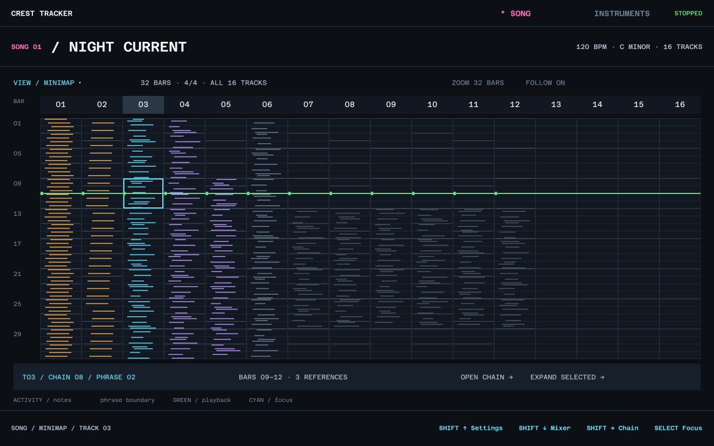

# Song Minimap — exploratory mode

Added to [T52 in Figma](https://www.figma.com/design/mvRQEFZc5Oi2ZbRkoHhXjH/Crest-Tracker?node-id=2110-5926), with a [T53 view picker](https://www.figma.com/design/mvRQEFZc5Oi2ZbRkoHhXjH/Crest-Tracker?node-id=2110-5958). The normal Song screen has a View entry and prototype links to the popup. The user's Stria reference is saved in the references folder.

The mode itself is requested. Its current layout and interaction details are provisional: 16 compact lanes, musical time running downward, a 32-bar example viewport, activity stripes, phrase boundaries, a focused occurrence and playback position. The screenshot data is illustrative, not an export of an actual composed song. The displayed meter is an example, not a 4/4 limitation.

Chains remains the normal default Song view. Minimap is another projection of the same arrangement. Expanded still comes from selecting multiple chain occurrences and shows their phrases with separators. No new Pattern model, note storage, scheduler or cursor type is introduced by changing modes.

The projection needs stable song/track/chain-use/phrase-use paths, a bounded musical-time viewport, document/runtime revisions and activity summaries. A focused stripe must resolve to a source occurrence, even when repeated material appears more than once. Independent cursors are shown on the shared musical-time axis; they are not forced to share chain or phrase row indices.

Still open: note-density versus pitch encoding; minimum visible subdivisions; zoom/scroll/follow; narrow-screen behavior; direct controller shortcut; repeat/jump rendering; whether generator previews show a current realization or a statistical summary. Infinite or conditional control flow requires bounded preview, never a blocking full-song expansion.

Acceptance: switching Song modes leaves NoteData and MIDI output unchanged. Navigation and Make Unique still target the correct source occurrence. Preview work cannot block the real-time sequencer. See A15 in the architecture guide.
