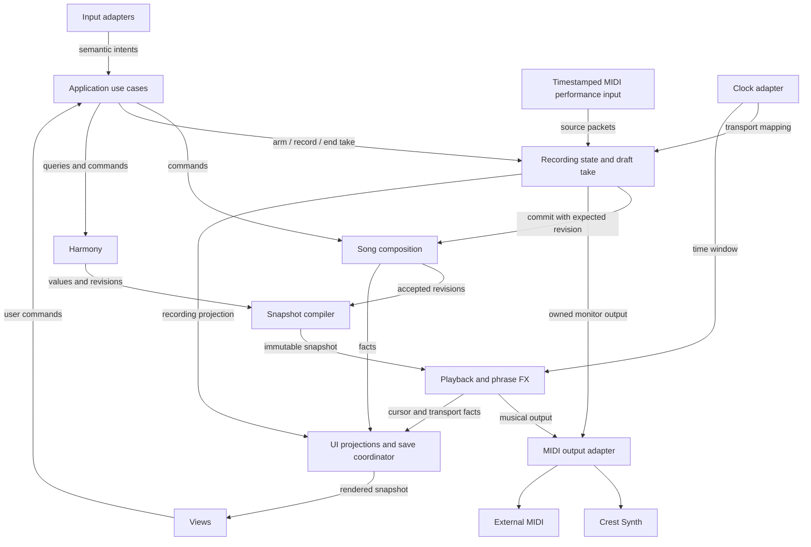
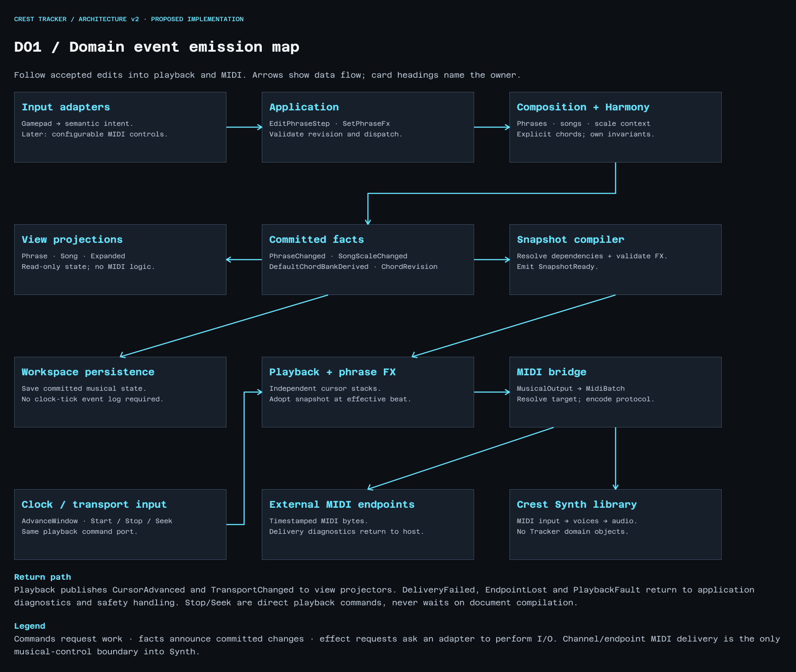
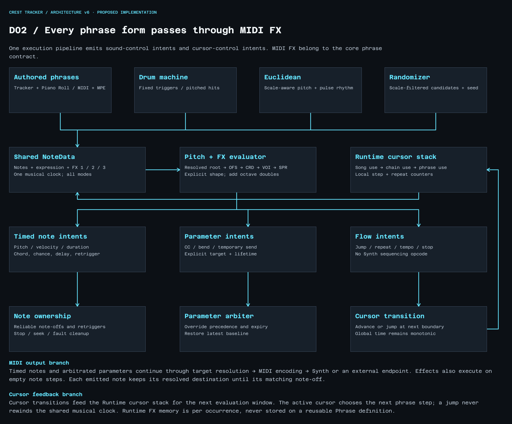

# Event map and contracts

Updated 15 October 2026. Names are proposed application/domain contracts, not verified existing Synth API symbols. Commands request an action; facts report accepted changes; I/O requests leave through ports. MIDI/sequencer FX are musical data, not application I/O effects.

The [native Figma event map](https://www.figma.com/design/mvRQEFZc5Oi2ZbRkoHhXjH/Crest-Tracker?node-id=2077-33) and [phrase FX pipeline](https://www.figma.com/design/mvRQEFZc5Oi2ZbRkoHhXjH/Crest-Tracker?node-id=2079-43) are included as PNG snapshots.

This is one process with explicit ownership and ports, not a proposal for distributed services. Only the host Synth adapter imports Synth. Synth receives its supported MIDI sound-control messages, never a phrase, cursor or jump command.

## Emission and ordering rules

- The controller adapter translates raw buttons/axis edges into semantic intents. Hold/release state is explicit and releases must not be discarded by input coalescing.
- The application validates commands and expected revisions, invokes the appropriate owner and coordinates transactions. Rejected commands emit no accepted-change fact.
- Composition/Harmony own musical rules. The compiler produces immutable, revisioned playback snapshots and keeps old valid snapshots when compilation fails.
- Playback owns monotonic musical time, independent occurrence cursors, FX/RNG memory, generated queues and active note ownership. Window boundaries are half-open and deterministic.
- At a shared timestamp for generated output: old note releases, parameter changes/restoration, then new note attacks. Captured packets preserve their within-source sequence, including expression after attack; initialization precedes attack and cleanup precedes channel reuse. FX stages define cross-family order; slot order resolves within-stage ties. Proposed global conflict rules are in A04/A08.
- Output acceptance means locally queued, not necessarily audible. Do not blindly retry Note On. Stop/seek invalidate unsent epochs and perform owned cleanup; already handed-off output requires the real adapter's cancellation contract.
- Projectors render facts/snapshots. They do not edit the authoritative document directly. Persistence saves document/resource state, not live cursors or held buttons.

## Contract matrix

| Producer / owner | Trigger | Emitted fact or output | Consumers | Ordering / failure contract |
|---|---|---|---|---|
| Input adapter | Gamepad buttons and axis edges | Semantic input intent | Interaction controller | Held modifiers are explicit; coalesce axis repeats, not release edges. |
| Composition | EditPhraseStep, SetPhraseFx, ConfigurePhrase | PhraseChanged(id, revision, dirtySteps) | Compiler, projectors, save coordinator | Expected revision required; rejected edits emit no change fact. |
| Composition | MakeUnique(occurrencePath) | ReferencesRelinked(copies, path) | Reference index, compiler, views | Copy and relink atomically; undo is one application transaction. |
| Harmony | SaveChord(customBankId, intervals, name) | ChordRevisionPublished | Catalog, explicitly updated Song references, compiler | Existing revision pins remain valid; Default entries reject edits. |
| Composition + Harmony query | SetSongScale(songId, key, expectedRevision) | SongScaleChanged; DefaultChordBankDerived | Compiler, generator cache, note and chord projectors | Commit key first; derive against its revision; discard stale derivations. Authored notes and pinned chord shapes stay unchanged. |
| Preferences / Composition | SetNoteEntryPolicy / SetPhrasePitchPolicy | PitchPolicyChanged / PhraseChanged | Entry controller, generators, projections, compiler | Resolve Inherit in the occurrence context. Chromatic overrides bypass pitch filtering. |
| Editor | SetPitchDisplay(Notes or Intervals) | EditorDisplayChanged | Phrase and generator projectors | Changes presentation only; no note rewrite or MIDI recompile. |
| Harmony | CopyChordToCustom(sourceShapeRevision) | CustomChordCreated | Custom catalog, save coordinator | New independent identity; copied source remains unchanged. |
| Harmony query | SearchChords(criteria, contextRevision) | ChordSearchResults | Search popup | Read-only result; Save is a separate explicit command. Discard stale query results. |
| Composition | SetPhraseFx(OFS / CRD / VOI / SPR) | PhraseChanged | Compiler, voicing preview, playback | Validate slot budget and parameter range; stable stage order; no post-chord scale quantization. |
| Compiler | Changed definitions | SnapshotReady / CompileRejected | Playback coordinator, views | Immutable dependency/version set; retain previous valid snapshot on failure. |
| Playback | ActivateSnapshot(effectiveBeat) | SnapshotActivated | Runtime projector | No earlier than already delivered output horizon. |
| Playback | AdvanceWindow([start,end)) | MusicalOutput, CursorAdvanced, PlaybackFault | Delivery adapter, view projector | Half-open windows; deterministic source IDs; bounded transition budget. |
| Playback | StopPlayback / Seek / lane fault | TransportChanged plus cleanup output | Delivery adapter, UI | Cancel unsent epoch, emit owned releases and override restoration before new attacks. |
| Parameter arbiter | Phrase override / manual baseline / expiry | EffectiveParameterChanged | MIDI encoder, sound projection | Same effective time uses stable ordering; expiry reveals latest baseline. |
| Output adapter | MusicalOutput | MidiBatch / DeliveryAccepted / DeliveryFailed | Synth or external endpoint; diagnostics | Accepted means locally queued, not audibly played; never blindly retry Note On. |
| Device adapter | Endpoint disconnected | EndpointLost | Playback safety, UI | Cancel future work; physical cleanup may be impossible until reconnect. |
| Song document lifecycle | SaveSong / SaveSongAs / OpenSong / NewSong | SongSaved / SongOpened / SongCreated / failure | UI, compiler, catalog | One Song per document. New/Open replaces it after Save/Discard/Cancel; failure preserves current state. Save establishes only the exact written capture as clean; later edits stay dirty. |
| Sound configuration | AdoptSoundRevision(useId, definitionId, revision, expectedRevision) | SoundRevisionAdopted / failure | Song capture, sound projection | Explicit update preserves local routing/mix. Structural adoption commits only after matching activation acknowledgement; failure retains the previous pin and configuration. |
| Preferences | SetBrowserRoot(assetType, token) | BrowserRootChanged | Asset browser, settings projection | Machine-local path/token; missing or inaccessible path gets a visible fallback. |
| Synth integration | Observed public sound state | SoundSnapshotObserved | Read-only sound UI projector | No Synth object ownership crosses into Tracker; mutations still use approved MIDI controls. |

## Piano Roll recording and editing

| Owner | Input / command | Result | Contract |
|---|---|---|---|
| MIDI input adapter | Device packet | PerformanceInput(sourceSession, monotonicTime, sequence, message) | Validate bytes/zone and preserve raw values. No UI intent translation or output-loop recapture. |
| Recording application | ConfigureCapture / ArmCapture | CaptureArmed(occurrence, mapping, revision) or rejection | Resolve shared edit policy; validate source, target capabilities and MPE configuration. Arm alone records nothing. |
| Recording application | BeginTake / timestamped input | CaptureStateChanged, draft projection, owned monitor intents | Map through tempo history. One armed occurrence; bounded queue; no draft replay. Preserve attack identity and expression. |
| Recording + Composition | EndTake / CommitTake(takeId, expectedRevision) | PhraseChanged and TakeCommitted, or recoverable conflict | One atomic undoable append; never overwrite concurrent edits. Activate on eligible future loop; monitor is not replay. |
| Recording safety | Stop / Seek / input loss / overflow | TakeInterrupted or TakeFinalized, scoped cleanup | Preserve known material and diagnostic. Reconnect does not rearm. Output loss cannot prove physical silence. |
| Composition | EditNotes / EditExpression / QuantizeSelection | PhraseChanged | Stable IDs, exact timing/values, owned expression and explicit scope; undo restores original values. |
| Editor | SetPianoRollGrid / SetRollZoom / SelectLane | EditorDisplayChanged | No retiming, recompile, scale correction or music mutation. |
| Output adapter | Monitor/playback intent | Allocated MPE output or capability/capacity rejection | Share destination allocation across producers; retain leases through sustain; never reset another owner's channel. |
| Song lifecycle | Save / New / Open with capture draft | Finalized take and immutable save, or existing guard outcome | Draft counts as unsaved; failed commit/save preserves it. See design/piano-roll.md. |

Detailed semantics and acceptance fixtures: [Piano Roll](design/piano-roll.md), architecture A16. Input/recording and output event names are proposed contracts, not existing Synth APIs.

## Song view-only additions

| Owner | Proposed intent | Result | Must not do |
|---|---|---|---|
| Editor | SetSongViewMode | Editor view mode changes; relevant projection refreshes | Rewrite NoteData or restart transport |
| Editor | FocusMinimapOccurrence | Stable occurrence path becomes focused | Infer source identity only from a visual row |
| Navigation | OpenFocusedChain | Existing Chain view opens at that occurrence | Create a separate minimap chain definition |
| Editor / Workspace policy | SaveViewGroup | Store selected occurrence references | Create an independently sequenced Pattern |

## Phrase FX stages

Resolve scale-aware note/root and explicit target → OFS chromatic offset → literal CRD shape → VOI placement/inversion → SPR added octave voices → probability/timing/gate/retrigger → capability validation and MIDI encoding. No post-chord scale quantizer. Three slots remain the authored budget. FX-only events, effect lifetime, control-flow intents and note-off cleanup are evaluated even when a row has no note attack, according to each descriptor.

